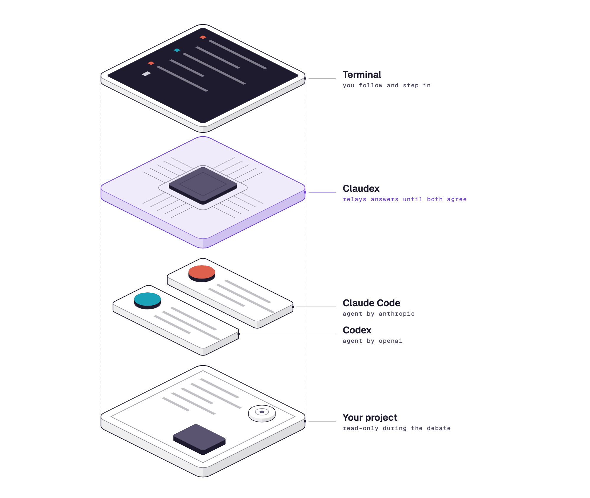

# Claudex

[](https://github.com/hooop/claudex/actions/workflows/ci.yml)

**Claude Code and Codex debate your technical question until they agree. You watch, step in, and decide.**

<picture>
  <source media="(prefers-color-scheme: dark)" srcset="docs/diagram/claudex-diagram-dark.png">
  
</picture>

## Why

Asking two coding agents for a second opinion usually means copying one answer into the other, back and forth. Claudex does the relay for you, in one terminal, attached to your project, before any code is written. Use it to choose between two approaches, review existing code, diagnose a bug or weigh a trade-off.

## How it works

1. You ask a technical question.
2. Claude answers, and Claudex forwards the answer to Codex. Codex answers, and Claudex forwards it back.
3. The cycle repeats until both agents explicitly agree.
4. Claudex prints a summary of the decision.
5. `/handoff` writes it to a markdown file for a later `claude` or `codex` session, or `/implement claude|codex` lets one agent build it right away.

## Highlights

- **Read-only debate.** Both agents can read your code; neither can change it until you run `/implement`.
- **Verbatim relay.** Answers are passed on in full, never summarised.
- **You stay in control.** `Esc` pauses at any moment. A plain message goes to both agents, `/claude` or `/codex` to one.
- **No turn limit by default.** The debate runs until consensus, or until an optional limit you set.
- **Project memory.** Decisions and constraints live in `.claudex/memory/`, so each debate starts from what was already settled.
- **Your files stay yours.** Claudex never creates or edits `CLAUDE.md` or `AGENTS.md`.

## Safety in short

- **Your code goes to two providers.** What the agents read is sent to Anthropic and OpenAI.
- **Agents cannot write during a debate.** Codex runs in a read-only, network-disabled sandbox. On macOS, Claude Code's shell runs in Claude Code's own sandbox; on other platforms it keeps only its file-reading and search tools.
- **Repository settings need your consent.** If the project's `.claude/settings.json` asks Claude Code to run a command or set environment variables, Claudex shows them at launch and starts nothing until you accept.
- **Read-only does not mean private.** A command can still read other files your account can access. Do not point Claudex at untrusted code.

The full, measured details are in [docs/security.md](docs/security.md).

## Quick start

You need Node.js 22 or newer, a Claude Code account and a ChatGPT plan that includes Codex.

> [!NOTE]
> No API key is needed: Claudex reuses your signed-in Claude Code and Codex sessions.

> [!IMPORTANT]
> If `ANTHROPIC_API_KEY` is set, Claude Code may bill per token instead of using your subscription. `echo $ANTHROPIC_API_KEY` should print nothing.

**1. Check Node.js** (v22 or newer)

```bash
node --version
```

**2. Install Claude Code**, sign in on first launch, then `/quit`

```bash
npm install -g @anthropic-ai/claude-code
claude
```

**3. Install Codex**, sign in on first launch, then quit

```bash
npm install -g @openai/codex
codex
```

**4. Install Claudex** from source

```bash
git clone https://github.com/hooop/claudex.git
cd claudex
npm install
npm link
```

> [!TIP]
> `npm link` makes the `claudex` command available everywhere. Do not move the folder afterwards.

**5. Run it** from the project you want to discuss

```bash
claudex
```

Or start straight on a topic:

```bash
claudex "What architecture should the video timeline use?"
```

Something wrong? See [docs/troubleshooting.md](docs/troubleshooting.md).

## Essential commands

| Command | Effect |
|---|---|
| plain text | Sent to both agents; on the welcome screen, starts the debate |
| `/claude <text>`, `/codex <text>` | Sent to one agent only |
| `Esc` | Pauses the debate, even mid-answer |
| `/handoff` | After consensus, writes the decision to a markdown file |
| `/implement [claude\|codex]` | Lets the chosen agent implement the agreed plan |
| `/new` | Archives the session and starts over |
| `/quit` | Archives the session and exits |
| `/help` | Lists every command |

The full command reference and the interface details are in [docs/usage.md](docs/usage.md).

## Updating

Claudex is installed from source, so updating is a pull away:

```bash
cd path/to/claudex
git pull
npm install
```

To hear about new versions without following every commit, open the [repository](https://github.com/hooop/claudex), click **Watch → Custom → Releases**, and GitHub will notify you of each release.

## Contributing

[AGENTS.md](AGENTS.md) describes the stack, the commands (`npm run check` must pass before a pull request), the conventions and the constraints. `CLAUDE.md` imports it, so Claude Code and Codex read the same guide.

## License

[MIT](LICENSE).
